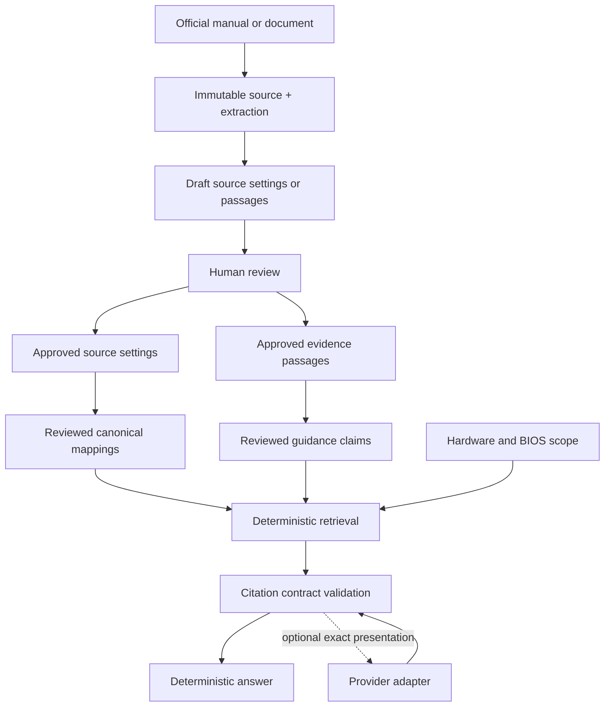

# TuneForge v1.33 architecture and operating model

## Product boundary

TuneForge is a citation-first BIOS settings platform. The public product has four
surfaces: BIOS Settings, Compare Vendors, Ask TuneForge, and Upload Manual. The
administrator workspace owns extraction, provenance, review, canonicalization,
evidence, claims, conflicts, research intake, and release operations.

The AI provider is optional and is never the source of truth. The application remains
fully functional with no paid model and rejects unsupported answers instead of using
model memory.



## Trust model

Extraction output, canonical suggestions, guidance candidates, live research, and
model output are candidates—not facts. Public reads use approved read models only.
Rejected and draft records, reviewer notes, audit internals, and unreviewed research
are not exposed as verified knowledge.

Every published factual path must remain traceable:

```text
Question
  -> canonical/source setting
  -> hardware and BIOS applicability
  -> reviewed claim
  -> evidence passage and page
  -> original source and provenance
```

Append-only event tables record manual, setting, mapping, evidence, claim, research,
recommendation, conflict, and authentication decisions. Mutable projections make the
current review state efficient to read; event history preserves how that state was
reached.

## Application layout

- `app/main.py`: FastAPI assembly, middleware, exception policy, and lifespan.
- `app/web/routes`: HTML public and administrator workflows.
- `app/api/v1`: versioned JSON contracts.
- `app/domain`: review, retrieval, applicability, conflict, quality, and presentation
  rules.
- `app/db/models.py`: SQLAlchemy persistence model.
- `app/extraction`: PDF and setting extraction.
- `app/search`: approved-setting FTS5 index and read paths.
- `app/research`: bounded official-web research and provenance capture.
- `app/llm`: provider-neutral presentation adapters.
- `app/operations`: backup, restore, and production preflight.
- `migrations`: Alembic schema history; current revision is `0027`.
- `tools`: read-only audits, evaluations, backup/restore CLIs, and reviewed data waves.
- `tests`: unit and HTTP/integration contracts.

## Knowledge objects

### Manuals and Source Settings

A manual stores provenance, immutable file identity, document metadata, hardware
applicability, extraction status, and review history. Extraction creates Source
Settings with literal vendor labels, descriptions, page references, menu context, and
document context. A Source Setting becomes public only after approval and trusted
manual eligibility.

### Canonical Settings and vendor mappings

A Canonical Setting is a reviewer-controlled identity for one BIOS function. Approved
mapping rows connect Source Settings to that identity; aliases are explicit reviewed
data. Similar names alone never establish equivalence. Canonicalization considers
semantics, behavior, menu context, hardware scope, source context, aliases, and
evidence. Uncertain records remain classified in the backlog.

### Evidence and Guidance Claims

Evidence Sources are provenance-pinned official or reviewed documents. Extraction
creates immutable page-scoped passages. Guidance Claims are atomic reviewed facts
bound to passages and setting identities. Definition, behavior, constraint, and safety
facts stay distinct. Hardware and BIOS-version scope are explicit relationships, not
free-form inference.

### Research and promotion

Live official-web research is an opt-in lead-generation surface. Runs, URLs, excerpts,
hashes, status events, and retrieval times are stored separately from verified
knowledge. A reviewer may promote a result into Evidence Intake; it must then pass the
normal source, passage, candidate, and claim review boundaries before becoming public.

### Recommendations

Recommendation Claims have a separate schema and review workflow for action, value,
risk, prerequisite, confidence, evidence, hardware scope, BIOS scope, and conflicts.
They are intentionally excluded from public answers until an exact applicability and
safety resolver is accepted. TuneForge currently explains verified facts but refuses
unsupported “best settings” advice.

## Ask TuneForge and optional models

Ask TuneForge resolves reviewed canonical names and aliases, fixed accepted guidance
questions, and approved Library discovery. Unknown, recommendation, exact-system, or
BIOS-version questions fail closed when the required reviewed facts are missing.
Refusals are logged without weakening retrieval and can include reviewer-registered
official referral pointers.

OpenAI, Anthropic, Gemini, and OpenAI-compatible adapters implement one strict
presentation contract. Only retrieved claim packets and citation metadata cross that
boundary. The user query, hardware profile, referral links, secrets, and raw unreviewed
research do not. Provider output must preserve the facts, order, notices, and citations
exactly; otherwise deterministic rendering replaces it.

## Hardware and BIOS applicability

Stable normalized entities cover vendors, platforms, chipsets, motherboard families
and models, CPU vendors, architectures, families, models, and aliases. Claim and
recommendation scopes attach to these identities. BIOS scope records literal version
bounds and notes only when evidence supports them. Request-scoped hardware context is
not persisted and never expands claim applicability.

## Ingestion and administrator workflow

```text
upload PDF
  -> PDF/type/size/page/hash validation
  -> provenance and eligibility review
  -> extraction run
  -> draft Source Settings
  -> setting review and manual acceptance
  -> public Source Settings
  -> canonical mapping review
  -> canonical Library and comparison
```

Batch uploads isolate failures per file. Interrupted runs are failed safely on startup.
Nothing is auto-published. The operations dashboard reports guidance, mapping,
evidence, hardware, BIOS, recommendation, conflict, research, and demand backlogs.

## Database, search, and migrations

SQLite is the current single-instance production database. Foreign keys are enforced,
public setting search uses FTS5, and WAL permits public reads during bounded curator
writes. Production uses one application process and one worker. The database, upload
files, and evidence files form one recovery unit.

Use Alembic for every schema change:

```text
python -m tools.backup_data --output <new-backup-path>
python -m tools.check_production
python -m alembic upgrade head
```

Never reset or delete the live database to solve a migration problem. Significant
migrations require isolated upgrade/downgrade/upgrade testing where supported,
integrity and foreign-key checks, and a restore drill.

## Local development

```text
python -m venv .venv
.venv\Scripts\activate
pip install -e ".[dev]"
python -m alembic upgrade head
uvicorn app.main:app --reload
```

Python 3.12 or newer is supported. Local operation needs no external service or model
key. Runtime configuration is documented in `.env.example`; import it through the
process supervisor or shell rather than committing a secret-bearing `.env` file.

## Quality gates

```text
python -m ruff check .
python -m pytest -q
python -m tools.evaluate_ask_tuneforge
python -m tools.audit_public_bios_knowledge
python -m tools.audit_data_quality
python -m pip_audit -r requirements.lock
python -m alembic current
```

The final release process additionally creates a verified archive, restores it into a
new isolated directory, runs SQLite integrity and foreign-key checks against the
restore, and validates production startup plus health/readiness probes. A feature
branch is merged only after these gates pass and a human reviews the release report.

## Security and operations

Authentication is required by default. Passwords are salted PBKDF2-HMAC-SHA256;
sessions are opaque, server-side, revocable, HttpOnly, SameSite strict, and secure in
production. Unsafe writes require same-origin confirmation. Trusted hosts, HSTS, CSP,
frame protection, MIME protection, method-aware public routing, bounded uploads,
fail-closed URLs, DNS-pinned HTTPS research, rate limits, request IDs, structured logs,
privacy-safe metrics, and storage/database readiness checks form the production
boundary.

See these current documents for detailed contracts:

- `v1.33-guidance-coverage.md`
- `v1.33-canonical-backlog-classification.md`
- `v1.33-research-evidence-intake.md`
- `v1.33-guidance-hardware-applicability.md`
- `v1.33-bios-version-awareness.md`
- `v1.33-knowledge-conflicts.md`
- `v1.33-retrieval-quality.md`
- `v1.33-ask-evaluation-suite.md`
- `v1.33-recommendation-foundation.md`
- `v1.33-grounded-llm-providers.md`
- `v1.33-admin-knowledge-operations.md`
- `v1.33-data-quality-audit.md`
- `v1.33-performance.md`
- `v1.33-security-audit.md`
- `v1.33-rate-limiting.md`
- `v1.33-observability.md`
- `v1.33-production-deployment.md`
