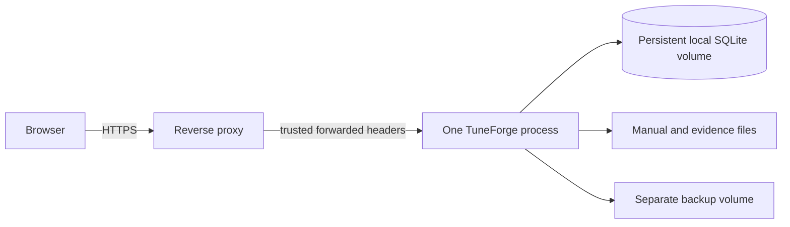

# TuneForge v1.33 production deployment

## Deployment decision

TuneForge remains a single FastAPI process backed by SQLite. That is the correct
production shape for the current workload: public traffic is read-heavy, curation
writes are comparatively infrequent, ingestion is bounded, and the process already
owns reviewer workflows, search, and backup coordination. PostgreSQL would add an
availability dependency without solving a measured bottleneck.

The supported v1.33 topology is therefore:



Run exactly one application container and one Uvicorn worker. WAL permits readers
to proceed during a curator write, but it does not turn a local SQLite file into a
multi-host database. Do not place the database on NFS, SMB, an ephemeral filesystem,
or a volume concurrently mounted by multiple application instances.

Reconsider PostgreSQL only after measurements show sustained concurrent writers,
horizontal application scaling is required, or the hosting platform cannot provide
a durable single-writer block volume.

## Container guarantees

The production image:

- pins the Python 3.12 patch image and the tested runtime dependency closure;
- runs as an unprivileged user with bytecode writes disabled;
- writes only to `/data`, `/backups`, and the runtime temporary filesystem;
- validates configuration and every durable write boundary before migration;
- applies Alembic migrations before accepting traffic;
- runs one Uvicorn worker;
- exposes `/api/v1/health` for liveness and `/api/v1/ready` for readiness;
- stops on `SIGTERM` so the server can drain cleanly.

The production Compose override additionally removes Linux capabilities, prevents
privilege escalation, makes the root filesystem read-only, and provides a bounded
temporary filesystem. The base `compose.yaml` is a local-development profile and
must not be exposed directly to the Internet.

Docker was not installed in the development environment used to prepare v1.33, so
the Dockerfile and Compose contracts are statically reviewed and application startup
is validated natively. Build the image in CI or on the deployment host before release.

## Required environment

At minimum configure:

```text
TUNEFORGE_TRUSTED_HOSTS=bios.example.com
TUNEFORGE_FORWARDED_ALLOW_IPS=127.0.0.1
```

The container supplies safe production defaults for environment, authentication,
secure cookies, rate limiting, JSON logs, WAL, `/data`, and `/backups`. Never commit
an LLM key. If a provider is enabled, inject `TUNEFORGE_LLM_API_KEY` through the
hosting secret manager.

`TUNEFORGE_FORWARDED_ALLOW_IPS` must contain only the reverse proxy's exact address
or CIDR. Do not use `*` while the application port is reachable by untrusted clients.
TuneForge intentionally installs no CORS middleware: browser writes are same-origin
only.

Run the fail-fast check before every migration:

```text
python -m tools.check_production
```

It prints paths and non-secret SQLite settings only. It validates runtime policy,
database sidecar creation, and create/delete access in uploads, evidence, and backup
storage.

## Build and start

From a clean checkout:

```text
docker compose -f compose.yaml -f compose.production.yaml build --pull
docker compose -f compose.yaml -f compose.production.yaml up -d
docker compose -f compose.yaml -f compose.production.yaml ps
```

The base port mapping binds only to `127.0.0.1:8000`. Put Caddy, nginx, or the
hosting platform's managed proxy in front of it. The proxy must:

- redirect HTTP to HTTPS;
- terminate TLS with a valid certificate;
- preserve `Host`;
- set `X-Forwarded-Proto` and `X-Forwarded-For`;
- enforce a reasonable request-body limit at least as strict as TuneForge's upload
  policy;
- use the configured trusted proxy address.

Example Caddy site after DNS points at the host:

```text
bios.example.com {
    reverse_proxy 127.0.0.1:8000
}
```

Replace the example hostname; no TuneForge domain ownership is assumed.

## First boot and probes

Open `/setup` over HTTPS and create the first administrator. Then verify:

```text
curl --fail https://bios.example.com/api/v1/health
curl --fail https://bios.example.com/api/v1/ready
```

Readiness requires schema `0027`, SQLite quick-check success, no foreign-key
violations, initialized authentication, and write access to all durable directories.
The process-local administrator metrics endpoint is
`/api/v1/operations/metrics`; export it through a protected collector if needed.

## Persistence and concurrency

TuneForge configures:

```text
journal_mode = WAL
synchronous = FULL
foreign_keys = ON
busy_timeout = 30000 ms
```

The timeout absorbs short curator-write contention; it is bounded and does not hide a
stuck writer. Keep one worker and one instance because rate limits and operational
metrics are process-local and SQLite has one writer at a time. Monitor refusal,
provider, research, extraction, auth, rate-limit, readiness, and unhandled-error
metrics described in `v1.33-observability.md`.

## Backups and upgrades

Place `/backups` on storage independent from `/data`, then copy completed archives to
encrypted off-host object storage. A practical schedule is daily plus immediately
before every migration. Retention and encryption are deployment responsibilities.

Before upgrading:

```text
docker compose -f compose.yaml -f compose.production.yaml exec tuneforge \
  python -m tools.backup_data --output /backups/tuneforge-pre-upgrade.zip
```

Verify by restoring only into a new directory or temporary volume:

```text
python -m tools.restore_data /backups/tuneforge-pre-upgrade.zip \
  --restore-to /tmp/tuneforge-restore-check
```

Then pull/build the reviewed revision and recreate the single service. Startup runs
the preflight and Alembic upgrade before Uvicorn. If either fails, the service does
not accept traffic. Keep the verified archive and previous image available for
recovery. Never downgrade by deleting the live database.

## Hosting fit

Best fit today: a small VPS or container host with one persistent local block volume,
a second backup target, and managed or local HTTPS. DigitalOcean, Azure, AWS, and
similar infrastructure work when those requirements are explicit. Railway, Render,
or Fly.io can work only with a persistent volume, one replica, and an off-platform
backup export. Ephemeral/serverless filesystems are not compatible with this SQLite
and PDF corpus.

External actions still required for a public launch are a hosting account, persistent
volumes, domain/DNS control, TLS/proxy configuration, an encrypted off-host backup
destination, and optionally an LLM provider key. TuneForge remains fully functional
without the optional model key.

